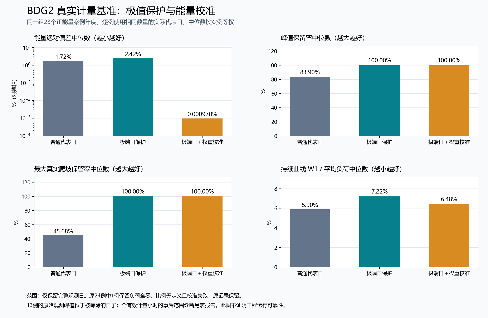

# 外部计量、三城空间与算法改进：本轮总报告

日期：2026-10-02。修改对象：原工程 `north_heat_challenge`，本轮为未发布增量。核心仍标记为 `11.12.0rc1`，增量身份以源码 SHA-256、冻结实验版本和本目录记录区分；没有同步 GitHub 上传副本或创建正式发布。

本轮完成了两组可复现的新实验：海外真实计量上的代表日对照，以及固原、乌鲁木齐、武汉的真实建筑—道路空间参考。同时修改了原算法和时间接口，独立审查发现的三个代码问题已修复。主要价值是让极端事件保留、能量权重拟合、空间连接和数据来源分别有实际证据，并保留不利结果。

## 1. 分工与验收顺序

| 对话 | 实际交付 | 统筹检查与纠正 |
|---|---|---|
| 供热数据与季节边界 | BDG2 12通道、24案例年度；旧/新算法与权重消融；原始观测范围敏感性 | 先冻结选样和协议；普通法逐例匹配实际代表日数；保留全零案例及校准失败；追加完整日筛选遗漏峰值的事后检查 |
| 供热空间与多尺度核查 | 三城各6个建筑、98条道路way、原生节点、路径、三份PNG/PDF地图 | 固定选点后再路由；要求保留道路中间节点、核验米制长度和跨层关系；固原失败不换点；修正地图编号重叠与PDF文字显示 |
| 供热独立物理与证据审计 | 原论文与代码映射；核心反例；原CSV/API响应独立复算 | 不调用实验适配器重算BDG2指标，不调用空间适配器重建路线；问题按旧版证据、新版源码身份和修复验证分别保存 |
| 统筹 | 核心代码修改、算法消融接口、全工程回归、总图、交付完整性检查 | 保存旧源码；修复RC时标、假爬坡和步长准入；回归发现Windows跨盘路径问题后修正并重跑 |

可并行部分已经并行：文献审阅、两类数据适配、协议制定和单元检查。严格顺序部分为：固定样本及规则 → 实验版本冻结 → 实际运行 → 独立复算 → 问题修复/对应重算 → 集成验收。旧版实验没有被新版覆盖。

## 2. 数据模块：这次实际用到了什么

- BDG2来自此前已完成官方LFS内容核验的CSV。选取热水、蒸汽、冷水各4个通道，共12个不同建筑、7个站点，每类覆盖4个站点，使用2016和2017年。选择依据为预先规定的质量条件、站点多样性和稳定ID顺序，没有按算法表现挑案例。
- 三城空间使用原24份OSM CSV，建筑ID预先冻结；有限补取98条道路的OSM原生节点引用和坐标，共保全6次API响应。98条道路补取几何与旧CSV一致。原CSV导出时刻未知，各API对象保留自身版本和时间，不视为同一时刻的城市快照。
- 原10份BDG2和24份OSM CSV共34份，前后字节数与SHA-256均核验；本轮不改原数据，不将缺测填成零。程序反例中的人工数值只用于测试，未混入观测实验。
- BDG2是海外外部基准，不能充当中国三城计量；三城OSM提供真实位置与道路，尚不提供建筑逐时热量、设备性能、管径和资产造价。

输入和实验身份见[交付完整性记录](delivery_verification.json)、[计量协议锁](external_benchmark/protocol_lock.json)、[空间输入完整性](spatial_reference/input_integrity.json)。

## 3. 算法模块：落实的改进

### 3.1 极端爬坡遵守真实时间关系

旧实现按每个24小时日块单独做差，漏掉23:00至次日00:00的事件。新实现只对同情景、同状态组、同来源年且相差恰好1小时的观测边做差，并保留最大变化事件两侧的实际日。缺日、跨年、跨情景不会拼成假爬坡；无法解析为真实时刻的旧模型键保留日内兼容模式，并显式报告该模式。

实测中仅一个案例的最大爬坡发生在午夜：`chilledwater__Bull_assembly_Beau/2017`，旧版保留率93.4177%，新版100%。该例代表日从9增至10；它证明旧实现遗漏被修复，不能作为同预算纯提升的证据。每版均另设相同实际日数的普通法对照。

### 3.2 代表日权重校准更稳健、性质更明确

保留原有“能量残差 + 权重偏移正则项”的软拟合目标，补入解析梯度、等式约束Jacobian、可行初值和求解后检查。拒绝非有限输入、负权重、缺失日ID和非法参数；显式记录总天数残差、权重下界违反量及能量偏差。

能量匹配仍是软目标，求解成功并不自动达到指定能量误差。23个正能量案例的实际消融见下节；今后正式采用候选权重还应设置预先规定的误差门槛并进行连续时序回放。

### 3.3 聚类与模型接口修复

- 重复日型少于请求K时按实际非空簇返回，避免空簇和复制日补预算。方法准确命名为“KMeans后选簇内最邻近质心的实际日”，不是严格k-medoids。
- 多气象年流程将真实时间与唯一模型标签分开；先在各原年度轨迹上计算RC相关锚点，再生成聚类标签，避免年份前缀破坏合法UTC输入。
- 覆盖审计只计算真实相邻观测，修复非相邻年份/缺日被误报成大爬坡的问题。
- 旧chronology CLI显式核对配置步长，2小时数据不再按1小时使用。
- 修正案例准备脚本在Windows跨盘输出时的相对路径异常；同盘保持相对路径，跨盘保存可解析的绝对本机路径。

核心问题IR-001、IR-002、IR-003已独立验证关闭。详细公式、源码前后身份和反例见[算法说明](algorithm/README.md)及[独立审查](independent_review/findings.md)。

## 4. 实验模块：收益及代价都保留

主图对三种方法使用同一组23个正能量案例年度、逐例相同实际代表日预算。下表为案例年度中位数；每年的权重都用该年数据拟合，因此属于压缩与内部消融，不是留出预测。峰值和爬坡表示原事件信息保留，不等于模型运行可行性。

| 方法 | 绝对能量偏差 | 峰值保留 | 最大真实爬坡保留 | 归一W1分布距离（越低越好） |
|---|---:|---:|---:|---:|
| 普通代表日，同实际日数 | 1.7166% | 83.90% | 45.68% | 5.8998% |
| 极端事件代表日 | 2.4242% | 100% | 100% | 7.2198% |
| 极端事件代表日 + 软权重校准 | 0.000970% | 100% | 100% | 6.4793% |

可展示的优势是：保留范围内，极端锚点能留下普通聚类遗漏的峰值和最大爬坡；固定选日后，软校准在23/23个成功配对中减小能量偏差，天数守恒最大残差为5.6843×10⁻¹⁴日，权重下界违反量为0。

与此同时，极端选日在能量偏差上相对普通法15/23例变差，W1分布距离17/23例变差。加权校准相对未校准极端法的W1有15例改善、8例变差；校准后的W1中位数仍高于普通法。当前结果支持“保留极端信息并改善能量拟合”，不支持“所有统计性质均优于普通法”。

完整日筛选是另一个实际风险。24个案例年度原计量覆盖率95.89%–100%，但仅保留274–364个完整日；13/24例的原始有效小时峰值在筛选后退出。主表100%峰值保留仅对保留日范围成立。追加的事后诊断保持选日不变，以全年全部有限非负观测小时为参考时，极端法峰值保留中位数99.57%，最差82.30%，13/24例仍有高于所选峰值的观测。这个诊断没有设备、储能、损失或系统求解，不是工程保供实验。

一个2017案例的保留计量全零，仍保留在固定24例中，相对指标记null并说明原因，权重校准失败原样记录。旧版48条、新版72条共120条方法记录中119条成功，1条失败。独立审查从原CSV重算全部119条成功记录并核查该失败，没有发现结果差异。没有将一条失败删除后补挑另一栋建筑。

完整结果、退出日期、原始计时、失败与范围诊断见[计量实验报告](external_benchmark/findings.md)。

## 5. 三城空间参考：三个城市全部使用

| 城市 | 固定真实建筑 | 道路way | 成功参考连接 | 保留失败 | 最大投影段长度相对误差 |
|---|---:|---:|---:|---:|---:|
| 固原 | 6 | 36 | 2 | 3 | 0.02540% |
| 乌鲁木齐 | 6 | 29 | 5 | 0 | 0.03704% |
| 武汉 | 6 | 33 | 5 | 0 | 0.04343% |

每城以首个固定建筑作为参考锚点，连接其余5个建筑；该锚点并不是热源。道路完整中间节点均保留，只有真实共享节点才产生原生连接，平面交叉不会自动变成路口。米制投影长度逐段与椭球测地线比较，上表是两种长度算法的差异，不是测绘误差证明。

固原3个失败的最近允许道路距离分别约175.02、185.45、209.32米，超过事先规定的150米阈值。保留原建筑和失败记录，没有换点把成功率做成100%。三城共15条连接状态均由另一套代码从原CSV/API响应独立复算一致。

三个城市已有位置—节点—道路—候选连接的完整可追踪关系。下一步接入供热规划时，还需逐字段引入有依据的建筑用途/面积、负荷、热源能力、管道物理与投资参数。当前空间接口中的这些字段为空，不能让缺失值悄悄变成虚构设备。

地图和可重跑命令见[三城空间成果](spatial_reference/README.md)：[固原](spatial_reference/guyuan/map.png)、[乌鲁木齐](spatial_reference/urumqi/map.png)、[武汉](spatial_reference/wuhan/map.png)。

## 6. 文献如何转化为模型和算法决策

| 原始文献/技术资料 | 对本项目的启发 | 本轮落实与下一步边界 |
|---|---|---|
| [Teichgraeber等，2020，Extreme events in time series aggregation](https://arxiv.org/abs/2002.03059) | 极端时段对规划约束有特殊作用，单纯统计聚类可能遗漏 | 落实真实相邻爬坡两端日保留和外部对照；文献中的运行失配反馈迭代尚未完整实现 |
| [Teichgraeber与Brandt，2022，时序聚合综述](https://optimization-online.org/wp-content/uploads/2022/01/8753.pdf) | 统计误差和投资/运行误差需要分开评价 | 同预算比较、权重消融与原观测范围敏感性；后续固定规划方案进行连续运行回放 |
| [Teichgraeber等，2021，迭代加入极端时段](https://optimization-online.org/wp-content/uploads/2021/08/8558.pdf) | 用完整运行检验发现缺供或排放约束失配，再增加关键时段 | 作为下一轮反馈选日设计依据；缺供与排放松弛应分别记录，不混成一个“通过”指标 |
| [Kotzur等，2018，季节储能状态聚合](https://arxiv.org/abs/1710.07593) | 周期内和周期间状态必须建立明确联系 | 维持来源年/状态边界；本轮跨日事件筛选不冒充季节储能状态分解 |
| [IEA EBC Annex58 ST4b](https://www.iea-ebc.org/Data/publications/EBC_Annex_58_Final_Report_ST4b.pdf) | 热动力学模型需要相应观测和模型阶数验证 | 先修复已有1R1C接口；有室温与热输入观测后再比较更高阶模型，不用缺少室温的BDG2强行识别热阻热容 |
| [BDG2作者论文](https://arxiv.org/abs/2006.02273)、[OSM API](https://wiki.openstreetmap.org/wiki/API_v0.6)、[PROJ UTM](https://proj.org/en/stable/operations/projections/utm.html) | 明确计量含义、对象身份和坐标度量 | 保全原始计量、节点版本和API响应；用真实道路长度与独立复算形成外部证据 |

以上文献用于解释选择和改进方向，论文中的改善比例没有移作本项目结果。本轮也核对了Bacher和Madsen（2011）的机构书目信息，但未成功读取作者全文，未把该文未读公式列为已实施内容。

## 7. 对评分维度的本轮增量

本表描述证据贡献，不自行认定赛事分数，也不代表该评分项全部完成。

| 评分维度及权重 | 新增可展示亮点 | 仍需补足的关键证明 |
|---|---|---|
| 系统架构，20分 | 原始数据、适配器、冻结版本、实验结果、独立审查相互可追溯 | 空间适配到真实物理输入的完整映射和三城端到端运行 |
| 动态特性，15分 | 真实午夜极端事件、跨年/缺日隔离、RC时间接口修复、计量事件检验 | 连续调度回放、室温观测验证；若使用季节储能需状态联系实证 |
| 情景适配，15分 | 三城市均有固定真实建筑和道路案例，失败保留 | 固原农宅与生物质、乌鲁木齐余热、武汉冷热耦合的真实参数及场景实验；当前市区空间样本不等于农村代表性证明 |
| 多目标优化，15分 | 本轮为后续成本/碳扫描提供更可靠的时间输入基础 | 本轮没有新增真实三城成本—碳排放ε扫描，不用计量压缩指标替代多目标前沿 |
| 多尺度，10分 | 建筑质心到道路、道路节点到路径的逐层映射与长度核验 | 有依据的建筑负荷聚合、管道容量/损失和源荷匹配约束 |
| 可视化分析，15分 | 三城地图、失败图例、同样本同预算四指标图，PNG/PDF检查 | 与真实规划结果联动展示敏感性、运行缺口和成本/碳前沿 |
| 代码质量，10分 | 669项主工程测试、23项空间专项测试、反例和独立复算 | 正式发布前在实际上传副本复核；本轮原工程验收不代替发布验证 |

## 8. 后续优先级：由实测暴露的问题驱动

| 优先级 | 任务 | 可并行与依赖 | 验收标准 |
|---|---|---|---|
| P0 | 对退出完整日的有效峰值建立单独压力检验 | 可与空间物理参数整理并行；先登记规则，旧协议不改写 | 不填造缺测；同时报告保留日和全部有效观测范围，列明无法连续回放的缺口 |
| P0 | 建立权重采用门槛 | 依赖当前能量/W1消融；先定门槛再新实验 | 能量、分布、极端下界、守恒分别检查；保留不能采用的候选权重及原因 |
| P1 | 增加最热日、冷负荷压力及多个尾部爬坡事件的选择策略 | 可独立开发；固定总日数后与现版本比较 | 当前最热5%日覆盖中位数为0、前1%正爬坡覆盖仅约5.06%，新方法须报告这两项及能量/W1代价 |
| P1 | 固定规划投资后的连续运行反馈选日 | 依赖有依据的设备/负荷参数、连续输入与明确边界 | 记录缺供、室温、储能和碳约束失配；在相同资源预算下比较运行结果，不只比较统计距离 |
| P1 | 三城真实空间映射到规划网络 | 可先逐字段整理来源，求解须等待物理准入 | 使用已验证道路几何而非重新用直线估长；每个负荷、容量、造价字段有来源和变换记录 |
| P2 | 更高阶建筑热模型与季节储能方法 | 等待相应观测及实验需求 | 与已有1R1C/明确连续基线比较预测或运行误差，参数可辨识，不能仅凭模型更复杂认定更优 |

## 9. 验证与重现

- 主工程全回归：[full_regression.xml](full_regression.xml)，669通过、1跳过、0失败/错误。跳过的是基础环境缺少可选pyproj时的空间测试模块。
- 同一主环境加载隔离空间依赖后另跑：[spatial_optional_tests.xml](spatial_optional_tests.xml)，23通过。这23项补上上述可选模块；58项核心集中测试、15项计量测试和17项跨盘检查已被主回归覆盖，不重复加总。
- 初次回归暴露Windows跨盘输出异常，已修复；[原失败记录](full_regression_initial_cross_drive_error.xml)保留，[17项针对检查](cross_drive_tests.xml)和最终全回归均通过。
- 独立审查从原数据复算计量指标与空间路径；该复算核验当前结果和实现问题，不替代真实工程外部观测验证。
- 总图数据与脚本：[图表数据](benchmark_summary_data.json)、[绘图脚本](plot_benchmark_summary.py)。数据来自冻结的新核心实验结果，图中使用同23例同预算。
- 运行 `python docs/execution_20261002/verify_delivery.py` 可重新核验34份原CSV、交付JSON合法性、测试结果及主要源码SHA-256；输出[delivery_verification.json](delivery_verification.json)。该脚本检查完整性，不重新运行所有实验或做科学审查。

尚未运行真实三城工程MILP、实际供热费用/减排对照、建筑参数识别或新的成本碳前沿，原因是当前新取得的数据支持计量算法基准和空间参考，尚未补齐对应物理、经济和运行观测。新增材料与这些后续工作各自的证据范围在本报告及分支记录中明确分开。
