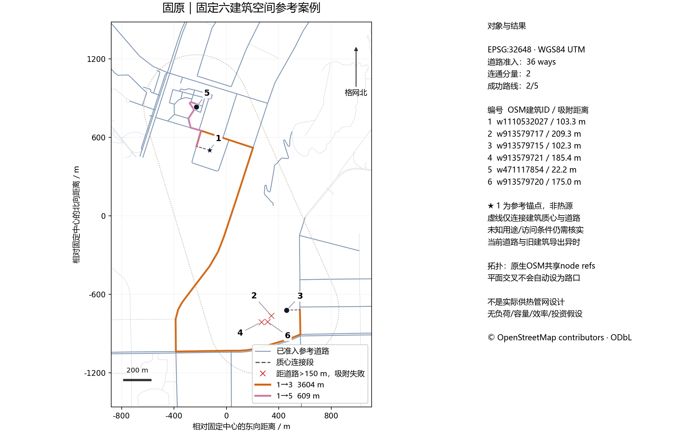
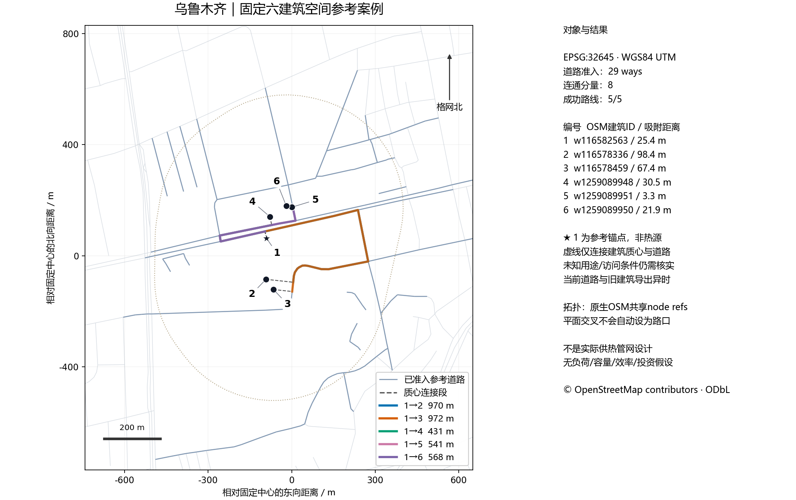
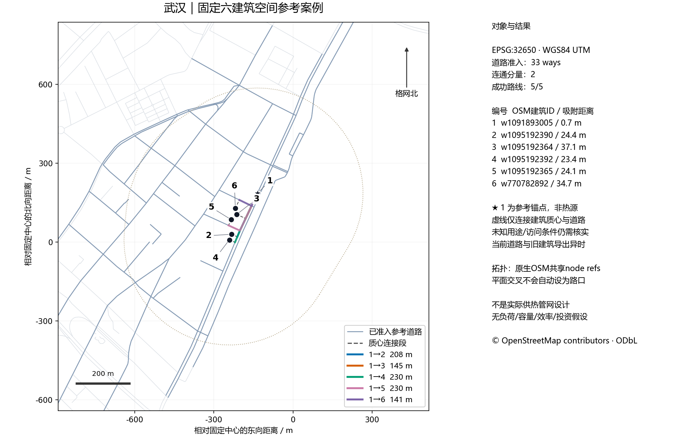

# 三城空间参考案例 · 2026-10-02

状态：空间参考实验版，未进入工程/MILP验收，不上传GitHub。固定选点与有限补取规则见 [protocol.md](protocol.md)。六个建筑由原CSV质心排序预先冻结，不根据路线成功重选。首个建筑仅作参考锚点，不是供热热源。

| 城市 | 建筑 | 准入道路way | 原生拓扑 | 吸附 | 路线成功/失败 | 分量 | 最大投影段误差 |
|---|---:|---:|---|---:|---|---:|---:|
| 固原 | 6 | 36 | 完整refs+节点 | 3 | 2/3 | 2 | 0.02540% |
| 乌鲁木齐 | 6 | 29 | 完整refs+节点 | 6 | 5/0 | 8 | 0.03704% |
| 武汉 | 6 | 33 | 完整refs+节点 | 6 | 5/0 | 2 | 0.04343% |

每城目录提供冻结selection.json、admission_report.json、native_intake.json、逐次请求及原始响应、connectivity.json、snaps/routes/failures、节点/边CSV与GeoJSON、逐段测地线误差、map.png/map.pdf和model_interface.json。完整道路way保留全部中间点和窗口外部分，不用道路两端直线代替。地图缩放展示建筑与候选走廊，完整way范围见distance_error.json。

原生拓扑只通过真实共享node ID连接，不自动增加二维交叉路口。同位置不同node ID不合并；不同层级内部共享node异常隔离，桥头真实端节点过渡另记。几何回退仅连相同原始坐标及未冲突层级签名，缺tag的默认0不表示同层已证实。无向道路只是候选供热走廊参考；oneway是交通方向，不能证明允许铺管。

建筑均来自旧CSV，导出时刻未知；道路/API节点是本次多次GET读取，保留各自version和timestamp，不声称原子城市快照。若旧/新几何改变，采用完整当前refs+coords配对，绝不把新refs挂在旧WKT上。未知access/建筑用途逐项保留，吸附线仅从建筑质心到道路，不是实测入口或合法支管；150m超距和失联均原样记录。

物理接口保持null：负荷、热损失、热惯性、热源容量、管径/容量、效率、投资均未推定。该schema不能直接输入现有模型；spatial_quality既有流程会用直线×route_factor覆盖长度，需显式映射并提供真实参数后才能接入。

数据：© [OpenStreetMap contributors](https://www.openstreetmap.org/copyright)，ODbL。有限补取依据 [OSM API 0.6](https://wiki.openstreetmap.org/wiki/API_v0.6)，层级/访问标签见 [layer](https://wiki.openstreetmap.org/wiki/Key:layer) / [access](https://wiki.openstreetmap.org/wiki/Key:access)。使用 [PROJ UTM](https://proj.org/en/stable/operations/projections/utm.html) 和 [pyproj Geod](https://pyproj4.github.io/pyproj/stable/api/geod.html) 进行独立逐段距离核查；误差表只评价本次投影与椭球测地线差值，不是测绘精度证明。

重跑：主工程Python加requirements-spatial-reference.txt中的可选pyproj、shapely、networkx、matplotlib。`python scripts/build_osm_reference_cases.py --offline`复用冻结选择和已保全API响应；缺响应会明确走几何回退。在线默认也优先使用已验证缓存，若需新的API时点请显式使用新的--output目录，不覆盖旧证据。_runtime_packages只为本次隔离可选依赖，不在交付清单内，不改变全局环境。

原始输入完整性：33个CSV/旧审核证据文件前后SHA256一致，变化数0；详见input_integrity.json。测试结果另见verification.json。未运行：MILP、实际供热性能/费用实验、开挖许可核验，原因是本批次只有空间参考数据。

## 固原

## 乌鲁木齐

## 武汉

验收：23项专项测试通过；三份PNG与单页PDF已视觉核验，建筑编号与固原超距失败图例可读。运行版本及未运行项见verification.json；正式交付文件SHA256见manifest.json。当前主环境未装pyproj时该测试模块明确skip，主项目回归由统筹任务负责，不以skip冒充通过。
