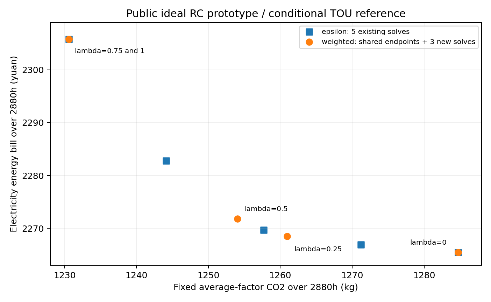

# 最终核验补记

本补记不覆盖冻结协议、旧结果、原图或源码。只保存命令核验输出，并调整图中文字位置；所有数据来自已冻结账本。

- 新增3个加权点均gap=0；0失败；10个点文件独立复算通过。
- 加权λ=0.75与λ=1的碳位置在预冻结归一容差1e-5内重合：5个预定位置得到4个不同碳位置；ε5点得到5个不同碳位置。
- 最大相邻归一碳间隔：加权0.43934047、ε0.25000046。这批ε覆盖更均匀；不能推论普遍优胜或完整前沿。
- 新增加权solver合计2.567048秒、记录wall7.863260秒；既有ε另5次38.098535/49.131149秒；共享端点4 stages共6.361631/11.099862秒。历史计时且次数不同，无等预算加速结论。
- 个别归一位置轻微小于0或大于1来自既有端点双阶段/ε容差，保留原值而未裁剪。
- 图轴是纯电量费；研究权重费用仅在账本单列。全部objective=C+pE的最大残差为7.276e-12元。
- 仅公开原型季节运行电量费与固定平均因子CO2；0新技术投资，不能称不同工程结构、实际账户结算、全工程经济或三城现场验证。

核验命令（工程根目录）：`D:/app/anaconda3/python.exe scripts/compare_reference_frontier.py verify`与`self-check`。原README还给出新目录freeze/run复现命令。

`manifest.json`保留求解交付时快照；`supplement_manifest.json`单独覆盖本补记、可读图及保存的核验输出，不假称原manifest涵盖后来附加文件。
