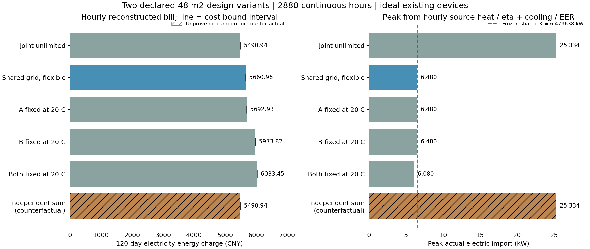
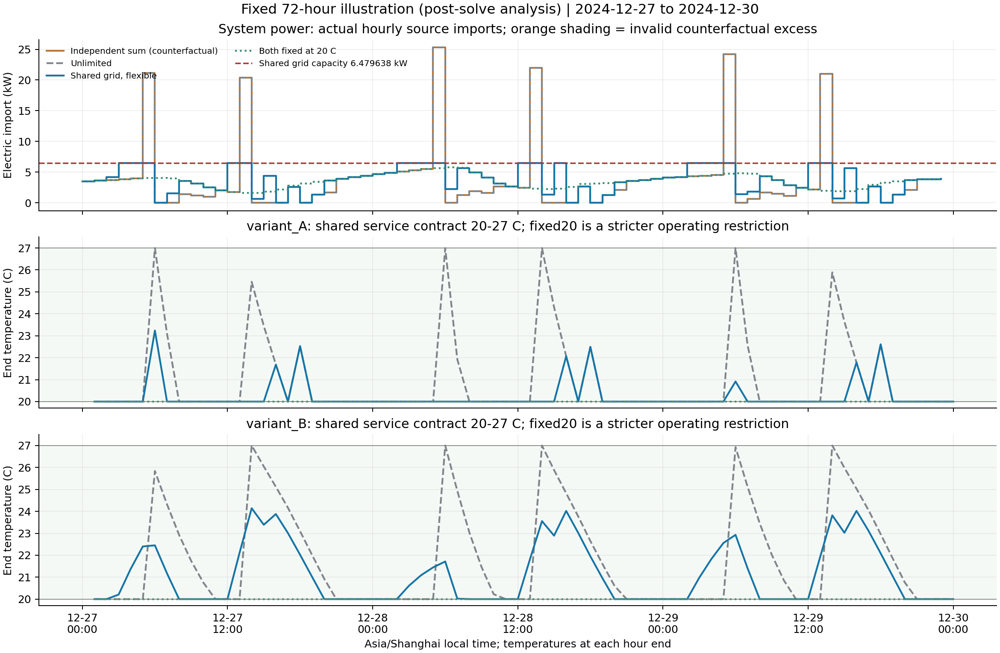
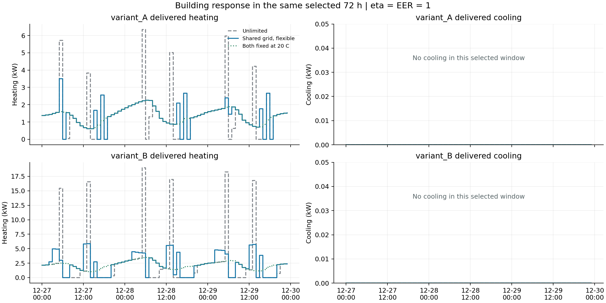

# 两楼共享电网数值参考实验：独立结果分析

本报告仅分析冻结后完成的 run_01，所有电量、电费、固定平均 EF 碳量、实际电网绑定与越限均由逐时原始出力重建。原始求解结果保持不变。

A 使用 48 m² BESTEST600 衍生 1R1C 参考参数 H=0.1043 kW/℃、C=0.535576 kWh/℃；B 是明确的设计变体，H 为 A 的 1.5 倍、C 为 A 的 4 倍，面积仍为 48 m²。两者同时改变 H 和 C，结果只能归因于整体设计变体与调度，不能声称识别了单一热容效应。每楼内部增益 0.2 kW、太阳增益 0，已有理想设备 η=EER=1，无投资。

共同服务为武汉参考天气下完整 2880 h、20–27℃、初末 20℃。共享电网容量先于求解按 (H_A+H_B)×(20−全窗最低室外温度) 冻结：K=6.4796375 kW。模型保留 portfolio_dispatch 静态 firm 约束；下面的实际绑定证据只来自逐时 Σ(heat/η+cooling/EER)，没有用静态 firm 变量等式充当运行绑定。

## 求解质量与失败记录

| 案例 | 状态 | 求解质量 | 失败说明 |
| --- | --- | --- | --- |
| independent_A | passed | solver_proven_optimal_within_registered_tolerance | — |
| independent_B | passed | solver_proven_optimal_within_registered_tolerance | — |
| joint_unlimited | passed | solver_proven_optimal_within_registered_tolerance | — |
| coupled_flexible | passed | solver_proven_optimal_within_registered_tolerance | — |
| coupled_A_fixed20 | passed | solver_proven_optimal_within_registered_tolerance | — |
| coupled_B_fixed20 | passed | solver_proven_optimal_within_registered_tolerance | — |
| coupled_all_fixed20 | passed | solver_proven_optimal_within_registered_tolerance | — |

passed 表示模型求解器在登记容差内证明最优且通过数值/物理/账目审计；feasible_unproven 表示通过审计的可行 incumbent，尚未证明全局最优。限时解、失败、不可行状态均保留。上下界仅针对相同 120 日电费目标，未把 MIP gap 换算成碳量或其他 KPI 的误差区间。

## 系统逐时重建指标

| 案例 | 状态 | 电费/CNY | 电量/kWh | 平均EF碳量/kg | 峰值/kW | 实际grid绑定/h | 相对共同K越限/h | 最大超额/kW | Σ超额/kWh |
| --- | --- | --- | --- | --- | --- | --- | --- | --- | --- |
| independent_A | passed | 2265.4287 | 3176.9211 | 1284.7469 | 6.3488 | — | 0 | 0.0000 | 0.0000 |
| independent_B | passed | 3225.5102 | 5548.5191 | 2243.8211 | 19.2381 | — | 226 | 12.7585 | 1795.5608 |
| joint_unlimited | passed | 5490.9389 | 8725.4402 | 3528.5680 | 25.3335 | — | 229 | 18.8539 | 2487.0216 |
| coupled_flexible | passed | 5660.9648 | 8386.0674 | 3391.3257 | 6.4796 | 530 | 0 | 0.0000 | 0.0000 |
| coupled_A_fixed20 | passed | 5692.9250 | 8374.3778 | 3386.5984 | 6.4796 | 500 | 0 | 0.0000 | 0.0000 |
| coupled_B_fixed20 | passed | 5973.8176 | 8039.9295 | 3251.3475 | 6.4796 | 64 | 0 | 0.0000 | 0.0000 |
| coupled_all_fixed20 | passed | 6033.4521 | 7953.9834 | 3216.5909 | 6.0796 | 0 | 0 | 0.0000 | 0.0000 |
| independent_sum_counterfactual | counterfactual | 5490.9389 | 8725.4402 | 3528.5680 | 25.3335 | — | 229 | 18.8539 | 2487.0216 |

独立单楼与 joint_unlimited 未施加共同 K，其“相对共同 K”列只作诊断；实际绑定列为空。拼接反事实则专门检验独立决策能否满足该共同资源。碳量使用固定平均 EF=0.4044 kg/kWh，仅是参考核算；没有 marginal EF、逐时边际排放或减排因果解释。

独立 A+B 拼接反事实：违反共同 grid 229 h，最大超额 18.853875 kW，Σ超额 2487.021598 kWh。因此它在共同 grid 下不是系统可行解，不能以它的低电费宣称可实施系统方案。

coupled_flexible 逐时实际电网绑定 530 h，峰值 6.479638 kW。实际共享上限被使用。

## 独立与 unlimited 的可分离一致性

配置/设备/服务/逐时输入检查确认 joint_unlimited 是两个独立问题的可分离并集，故数学上的最优目标满足 f*_unlimited=f*_A+f*_B。两个分别求解的 incumbent 可以不同，数值一致性应检查界区间。

独立最优和的区间为 [5490.938905, 5490.938905] CNY；unlimited 区间为 [5490.938905, 5490.938905] CNY。区间一致性：True；incumbent 电费差（独立和−unlimited）=0.000000 CNY。

## 共同 grid 成本与锁温消融

差额统一定义为右侧案例减左侧案例。coupled−unlimited 的 incumbent 差只描述已输出可行解；最优差区间由 right lower−left upper 与 right upper−left lower 得到。灵活性费用优势必须满足 coupled_flexible 的已审计 upper < 消融的 solver lower−1e−5 CNY；只比较两个 incumbent 不构成严格优势证明。

| 差额 | incumbent差/CNY | 最优差下界/CNY | 最优差上界/CNY | 严格费用优势由界支持 |
| --- | --- | --- | --- | --- |
| coupled_flexible_minus_joint_unlimited | 170.0259 | 170.0259 | 170.0259 | True |
| coupled_A_fixed20_minus_coupled_flexible | 31.9602 | 31.9602 | 31.9602 | True |
| coupled_B_fixed20_minus_coupled_flexible | 312.8527 | 312.8527 | 312.8527 | True |
| coupled_all_fixed20_minus_coupled_flexible | 372.4873 | 372.4873 | 372.4873 | True |

锁 A、锁 B、全锁 20℃属于同一 20–27℃服务合同内更严格的运行限制，三者可行域不同；不是用同一可行域证明不同算法优劣。共享 grid 与锁温消融的理论可行域包含关系可给出弱不等式，但不能取代严格费用差的求解器界证据。

共享 grid 的已输出电费相对 unlimited 增加 170.025943 CNY（3.0965%，以 unlimited 为分母）。其最优电费增加在登记求解器容差下也由目标上下界支持。

- coupled_flexible_minus_joint_unlimited：incumbent 差=170.025943 CNY；unlimited 的低费用在求解器容差下由非重叠界支持。
- coupled_A_fixed20_minus_coupled_flexible：incumbent 差=31.960195 CNY；灵活调度的低费用在求解器容差下由非重叠界支持。
- coupled_B_fixed20_minus_coupled_flexible：incumbent 差=312.852743 CNY；灵活调度的低费用在求解器容差下由非重叠界支持。
- coupled_all_fixed20_minus_coupled_flexible：incumbent 差=372.487264 CNY；灵活调度的低费用在求解器容差下由非重叠界支持。

本次所有锁温消融都得到已审计可行解，未观察到消融不可行。完整解析 fixed20 witness 的最大负荷=6.0796375 kW ≤ K，协议设计即保留了固定20策略的可行性。

## 从系统到建筑的响应

| 案例 | 建筑 | 电量/kWh | 电费/CNY | 谷段电量占比 | 最低末温/℃ | 最高末温/℃ |
| --- | --- | --- | --- | --- | --- | --- |
| independent_A | variant_A | 3176.9211 | 2265.4287 | 0.5000 | 20.0000 | 27.0000 |
| independent_B | variant_B | 5548.5191 | 3225.5102 | 0.8477 | 20.0000 | 27.0000 |
| joint_unlimited | variant_A | 3176.9211 | 2265.4287 | 0.5000 | 20.0000 | 27.0000 |
| joint_unlimited | variant_B | 5548.5191 | 3225.5102 | 0.8477 | 20.0000 | 27.0000 |
| coupled_flexible | variant_A | 3090.7044 | 2287.6171 | 0.4047 | 20.0000 | 26.0252 |
| coupled_flexible | variant_B | 5295.3630 | 3373.3478 | 0.6596 | 20.0000 | 25.2333 |
| coupled_A_fixed20 | variant_A | 3072.7304 | 2329.2366 | 0.3718 | 20.0000 | 20.0000 |
| coupled_A_fixed20 | variant_B | 5301.6474 | 3363.6884 | 0.6693 | 20.0000 | 25.2573 |
| coupled_B_fixed20 | variant_A | 3158.6765 | 2269.6021 | 0.4805 | 20.0000 | 27.0000 |
| coupled_B_fixed20 | variant_B | 4881.2530 | 3704.2155 | 0.3698 | 20.0000 | 20.0000 |
| coupled_all_fixed20 | variant_A | 3072.7304 | 2329.2366 | 0.3718 | 20.0000 | 20.0000 |
| coupled_all_fixed20 | variant_B | 4881.2530 | 3704.2155 | 0.3698 | 20.0000 | 20.0000 |

按 variant_A/B 对照 joint_unlimited 的每小时室温、heat/cool/electric 变化完整保存在 hourly_building_changes.csv。温度为小时末值，电热/电冷为小时内平均功率；电量与电费按 1 h 累计。谷段占比由输入 tariff_bucket=valley 定义，没有另设谷段阈值。建筑电费是各自 η/EER=1 的直接设备耗电账目分项，其和等于系统账目。

| 案例 | 建筑 | 平均末温变化/℃ | 最大绝对温差/℃ | 热量变化/kWh | 冷量变化/kWh | 电费变化/CNY | 供热改变/h | 系统绑定/h | 绑定与反事实越限重叠/h |
| --- | --- | --- | --- | --- | --- | --- | --- | --- | --- |
| independent_A | variant_A | 0.0000 | 0.0000 | 0.0000 | 0.0000 | 0.0000 | 0 | — | 0 |
| independent_B | variant_B | 0.0000 | 0.0000 | 0.0000 | 0.0000 | 0.0000 | 0 | — | 0 |
| joint_unlimited | variant_A | 0.0000 | 0.0000 | 0.0000 | 0.0000 | 0.0000 | 0 | — | 0 |
| joint_unlimited | variant_B | 0.0000 | 0.0000 | 0.0000 | 0.0000 | 0.0000 | 0 | — | 0 |
| coupled_flexible | variant_A | -0.2870 | 7.0000 | -86.2167 | 0.0000 | 22.1883 | 418 | 530 | 229 |
| coupled_flexible | variant_B | -0.5619 | 6.2412 | -253.1562 | 0.0000 | 147.8376 | 1111 | 530 | 229 |
| coupled_A_fixed20 | variant_A | -0.5091 | 7.0000 | -128.5601 | 24.3693 | 63.8079 | 868 | 500 | 228 |
| coupled_A_fixed20 | variant_B | -0.5479 | 6.2412 | -246.8717 | 0.0000 | 138.1782 | 1076 | 500 | 228 |
| coupled_B_fixed20 | variant_A | -0.0607 | 4.2524 | -18.2446 | 0.0000 | 4.1734 | 140 | 64 | 60 |
| coupled_B_fixed20 | variant_B | -1.6080 | 7.0000 | -695.8989 | 28.6327 | 478.7053 | 1695 | 64 | 60 |
| coupled_all_fixed20 | variant_A | -0.5091 | 7.0000 | -128.5601 | 24.3693 | 63.8079 | 868 | 0 | 0 |
| coupled_all_fixed20 | variant_B | -1.6080 | 7.0000 | -695.8989 | 28.6327 | 478.7053 | 1695 | 0 | 0 |

建筑变化可能包含不同 incumbent 的求解差异。仅当成本界与可行域证据同时支持时，才称为严格费用机制；没有把两楼总体差异拆解成纯 C 效应。绑定时段统计是系统绑定时两楼出力与 unlimited 的差异，不是把系统容量分摊成未经声明的建筑限额。

variant_A 在共享灵活调度的实际绑定小时，平均电力相对 unlimited 变化 -0.622074 kW；在独立拼接越限小时，平均变化 -1.491138 kW。
variant_B 在共享灵活调度的实际绑定小时，平均电力相对 unlimited 变化 -2.337818 kW；在独立拼接越限小时，平均变化 -9.369218 kW。

## 固定的 72 h 展示规则（求解后分析）

选择共同 grid 下独立拼接反事实最大正超额的最早小时及所在日；若没有正超额或独立结果缺失，使用全窗最冷室外小时的最早日期。展示该日及相邻日 72 h，靠端点时平移到可用窗口。规则固定于求解后分析脚本，未列入求解前冻结 protocol；不是预注册确认或留出选择。没有为图形或效果事后改 K、物理参数或实验案例。

本次触发：earliest maximum positive independent-A+B counterfactual grid excess；时刻 2024-12-28T05:00:00+08:00；展示 2024-12-27T00:00:00+08:00 至 2024-12-30T00:00:00+08:00。所选片段仅作机制展示，全部指标与结论使用完整 2880 h。

费用图的黑线为同单位目标区间，斜纹表示尚未证明最优的 incumbent 或反事实。电网 K 的虚线只在实际受限案例中构成约束，反事实超限不构成可行方案。

所选 72 h 内没有冷量需求，冷量图据实显示为零。完整 2880 h 的 fixed20 消融存在保持 20℃所需的冷量，应以全窗表格和逐时文件为准。

## 适用范围与文件证据

这是公开原型、格点天气、条件适用分时电价和固定平均 EF 的数值参考实验。不是现场验证，不是武汉实测建筑或当地账户核实，不是 BESTEST 认证；B 也不是经过验证的 BESTEST900。理想已有设备、无投资、无生命周期成本，未补入未知费用为零。分时电价只覆盖参考账户的电量费，不能宣称当地用户真实账单收益、工程配网可行性或边际减排收益。

分析独立读取逐时 raw；保留父运行 manifest.json 并在前后检查其文件哈希。analysis_manifest.json 只登记本分析新增文件与脚本 SHA，不改父 manifest。summary.json 为机器可读结论与质量证据；full_tables.csv 汇总系统/建筑/界对照，hourly_system.csv 与 hourly_building_changes.csv 保留全部小时。
