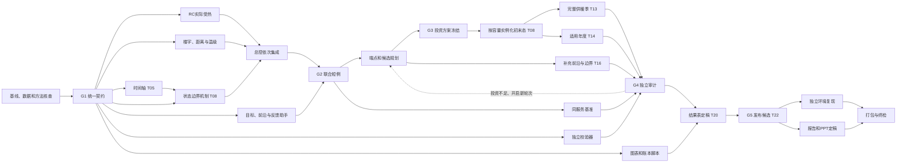

# 并行实施依赖与研究依据

日期：2026-10-01。基线11.11.1；原有工程上增量改进；执行预算24小时。本次进一步拆解依赖、核验方法与公开数据，不把研究完成写成模型已经改造完成。配套文件为[执行计划](24小时实施计划与多对话分工.md)、[算法方向复审](按评分标准复审的算法优化方向.md)、[权威来源索引](权威方法与数据来源索引.md)。

## 1 最重要的判断

当前瓶颈是服务定义、状态连续性和证据闭合。增加模型数量或同时启动更多求解，不能替代这些工作。优先在既有源网荷储MILP上修复实际供热—室温—可靠性—评价分母的一致性，再形成同一投资的完整季、适用年度和公平比较。复杂管网动态、系统㶲、跨季储热仍保留在差距表中，但以明确假设和有作用的最小接口先支撑主案例。

必须区分三个概念：开发可以开始、真实结果可以生成、任务可以最终验收。例如独立校验器在公式和接口冻结后就能开发，最终证书仍要等待冻结的真实结果；材料脚本可以用标为示例的夹具编写，经济结论只能从审核过的结果产生。

24小时表的前置列是当前资源排程，不是所有任务都存在数学依赖。H0只登记一次，不得在每轮研究后后移；若一天预算已开始，研究时间应计入已用时间，按剩余额度执行，不能默认再增加24小时。时间窗也不是人工工时估计；本次没有依据把若干窗口相加并声称并行节省了多少小时。

## 2 哪些可以并行，哪些必须顺序

| 工作 | 可并行部分 | 必须等待的关口 | 本机执行方式 |
| --- | --- | --- | --- |
| 资料与数据 | 气象、物性、设备、价格、排放和论文检索 | 正式入模等同一时间、单位和参数身份 | 多个轻任务并行，各留原始文件 |
| RC、层级、空间品质 | 各自独立模块、反例和数据映射 | 共享服务接口；主模型接入由总控依次完成 | 不同文件并行、共享核心单写 |
| 独立验收 | 解析解、负例、导出轨迹重算器 | 正式验收等真实完整输出 | 提前到H6启动，不必等主案例跑完 |
| 财务与材料 | 账本公式、章节、图表代码 | 最终数字等同服务结果和审计 | 先脚本后结果，缺失值报错 |
| 成本与低碳端点 | 同一模型下两端点互相独立 | 每个端点内部词典序第二阶段等第一阶段 | 默认一个大型求解排队 |
| ε前沿 | 端点确定后，预设ε点独立 | 用端点生成网格先等端点；自适应下一点等前一点 | 资源足够才增加进程，不混用结论 |
| 季节与年度 | 同一冻结方案、独立定义初态时可独立求解 | 若季初取自年度轨迹，必须先得到对应状态 | 默认排队；数学上不人为加依赖 |
| 不同天气、价格、基准 | 各情景求解独立 | 比较等相同服务和各自有效认证 | 参数清单固定、输出目录隔离 |
| 完整动态轨迹 | 候选之间可并行 | 同条轨迹的温度、SOC、启停、燃料状态逐时承接 | 不能随意按月切开独立求解再拼接 |
| 失败反馈 | 诊断器和调度器可提前写 | 第n+1轮候选依赖第n轮违例；新方案重验 | 有限轮次、时间上限、保留失败 |
| 复现与文稿 | 发布候选冻结后可同时进行 | 打包等两者完成，终检等最终包生成 | 最后4小时保留给验证和交付 |

时间连续的优化不一定要求逐小时调用求解器，但状态约束必须保持联立。分块或滚动法只有明确传递全部边界状态、处理前瞻和终端影响，并通过完整轨迹重算后才可使用；不能因并行需要自动假定其等价于全年联立解。完整规模矩阵的构建、非零元数及内存测量应在H6—10联合检查中提前完成，只构建不必长时间求解。

## 3 关键路径和五个关口

图中只画投资不足的反馈；数据错误回T05，物理/初态错误回T06/T08/T09，空间温级错误回T07，目标错误回T10，再重验相关下游。若供暖季初态取自全年或预运行，增加该状态产物到T13的明确依赖。T16正式前沿必须进入审计；T17仅在正式引用时补入同一审计，未引用实验保留日志。T20图表可以提前准备，正式定稿依赖审计；T22冻结之后才做T24最终文稿。图中回边是条件反馈。机器检查使用单轮无环图，下一轮给新的run_id，不能把有反馈的全过程误称静态无环图。H2、H10、H11、H20等是预算检查时点，G1—G5是证据关口；到了某个小时不等于自动通过关口。

| 关口 | 名称 | 必备内容 | 责任任务 |
| --- | --- | --- | --- |
| G1 | 统一接口 | 时间与单位；负荷模式；状态边界；层级/温级；目标边界；输出及容差；建筑初版主表、全年冷服务路线、初始能量来源 | T02/T03/T27共同形成；总控冻结 |
| G2 | 联合小例 | 模块单测、跨层守恒、实际供热室温及目标分母一致 | T09/T10/T11 |
| G3 | 候选方案冻结 | 规划目标范围、推荐规则、投资及输入代码哈希 | T12 |
| G4 | 推荐方案认证 | 同一方案完整季、适用年度、公平基准及独立审计 | T13/T14/T15/T21；必要反馈回G3 |
| G5 | 发布候选冻结 | 已审计数字与结果表一致，代码数据配置结果身份冻结 | T20/T21完成后T22；其后T23/T24并行，T25打包，T26最终交付 |

H16依据剩余验证预算控制最终推荐方案的变更；这不是免验许可，仍无法认证时如实列未完成。推荐方案必须在完整回放前按预先登记的选择规则选出。T16晚到的额外折中点若更好，可以列为未经完整认证的候选；要换正式推荐，就要重新完成相应季节、年度和审计，不能在H19直接换图表中的方案名。

## 4 G1必须冻结的六份接口约定

| 约定 | 必填内容 | 主要冲突与验收 |
| --- | --- | --- |
| 时间及单位 | 内部统一UTC、展示时区、半开服务区间、dt、状态时点、平均功率区间；kW/kWh/℃/K | NASA LST不能直接贴北京时间；电价、占用、天气先在统一时钟对齐；闰年和边缘补齐 |
| 热服务 | building_id、load_mode、实际到户热量、DHW及其他固定服务、占用得热、舒适区间 | RC供热需求内生后不能再叠旧模板等式；计量节约必须有明确物理作用，不能凭变量免费减热 |
| 动态状态 | 室温、储热SOC、启停、燃料及实际启用的其他状态；初末态、边界历史与预热 | 初始能量不是免费供给；季节、年度是否共享初态说清；可靠容量需关键时段可兑现 |
| 层级与品质 | 楼宇→片区→城市映射、面积物性、候选连接、距离、温级、提温转换 | 至少形成有差异的建筑状态和逐层守恒；低温热不能无功变成高温热；只有节点改名不算多尺度 |
| 目标与核算 | 同一冷热服务边界，成本/排放表达式，现金成本与惩罚，投资和共享资产处理 | 碳帽与碳目标用同一式；财务与优化目标不混称；运营排放与生命周期排放分开 |
| 输出与审核 | run_id、父轮次、输入和投资哈希、字段单位、完整标记、状态/gap、分量容差 | 检查器从实际输出独立重算；缺列报错；未完成CSV不被下游读取；数值身份改变使证书失效 |

G1冻结首版建筑主表：building_id、district_id、area、H/C、占用、温级、冷热类型和参数身份。片区送达热量等于楼宇送达之和加独立固定服务，不能父子层重复计量。C2/C3在这份主表上并行；之后改变主表必须更新接口版本并重验。

S3在G1确定全年冷热RC或供暖季RC加年度冷负荷代理：前者必须在状态方程中加入负的实际送达冷量并完成楼宇分配；后者仅认证供暖季室温及年度能源/资源，不把代理冷量说成夏季室温已验证。不能全年施加供暖舒适上限却不提供制冷作用。

初始SOC若与新建容量挂钩，须说明预充、库存计价或全年承接的来源，末态规则与基准一致；初温同样明确预热边界。G1定义规则，G3之后依实际容量生成状态实例。

H、C和建筑面积不能任意独立缩放：H随围护和通风作用，C随可参与动态的热容量变化。典型建筑聚合须声明等效假设，并核对总面积、总热损和储能尺度。当前没有当地室温观测时，采用公开物性参考与区间假设，不称为当地实测辨识。

## 5 论文研究对工程的实质影响

1. **RC首先修实际受热。** [EnergyPlus系统积分说明](https://energyplus.readthedocs.io/en/latest/guides/engineering-reference/2.1-basis-for-the-zone-and-air-system-integration.html)将实际系统输出与温度修正联系起来；[Bacher与Madsen](https://doi.org/10.1016/j.enbuild.2011.02.005)支持从简单灰箱结构出发。现有虚拟状态不能只改名为室温。优先一阶RC解析步进与实际到户热量，增加阶数需要数据和残差依据。

2. **代表日统计和连续可行性分别验。** [Poncelet等](https://www.mech.kuleuven.be/en/tme/research/energy_environment/pdf/wp-2015-10b.pdf)提供能量、持续曲线、相关性及爬坡等诊断；[Teichgraeber等](https://optimization-online.org/wp-content/uploads/2021/08/8558.pdf)支持固定投资全序列回放与极端期补充。论文的失负荷可靠性不自动涵盖本项目室温、年度碳和跨季储能。反馈需带违例前后的状态上下文，不能只抓一天最大值。

3. **季储边界有容易漏掉的细节。** [Kotzur等](https://arxiv.org/pdf/1710.07593)说明跨期状态意义；[Blanke等](https://link.springer.com/article/10.1186/s42162-022-00208-5)进一步讨论每小时损耗衰减和期内越界。需要加入“期末合法但期中超限”“满SOC首小时仍充热”等负例，已有正确实现先保留。热泵地源年度恢复也不能只由冬季运行推断。

4. **前沿方法须与模型类型一致。** [Mavrotas配套技术报告](https://www.gams.com/modlib/adddocs/epscm.pdf)支持ε约束、词典序端点和增强处理；[AUGMECON2作者稿](https://mpra.ub.uni-muenchen.de/105034/1/MPRA_paper_105034.pdf)的精确集结论有整数结构及步长条件。当前连续容量MILP先实现正确端点、目标归一化、容差去重和支配过滤；距归一化理想点最近应如实命名，不能自动称几何膝点。

5. **管网与㶲先明确物理边界。** [Sartor与Dewallef](https://orbi.uliege.be/handle/2268/208016)及[Wurm等](https://arxiv.org/abs/1910.04573v3)说明热输运、管壁惯性和流速历史；现有管流单位kW，需先决定质量流量/供回温度如何进入。固定延迟只能是声明工况的近似。[IEA Annex49](https://www.iea-ebc.org/Data/publications/EBC_Annex_49_guidebook.pdf)要求参考环境和整条输入输出链；全季总输出㶲/总输入㶲与逐时效率均值不同。

6. **独立验证要提前，但证据等级不能混。** [IEA Annex58统计指南](https://iea-ebc.org/Data/publications/EBC_Annex_58_Final_Report_ST3b.pdf)与[经验验证报告](https://iea-ebc.org/Data/publications/EBC_Annex_58_Final_Report_ST4a.pdf)支持时间口径、残差、参数物理性和独立测量。解析解验证程序；独立模拟器重算验证数值一致；公开实验验证特定工况；当地实测验证当地效果。缺少最后一种时前三种继续做，结论清楚限于公开数据情景。

这些是实际读到的方法内容，不表示本项目已经达到原论文中的精度、速度或节能率。完整书目信息、阅读章节与缓存见配套索引。

## 6 参数和数据补齐顺序

先补会改变可行域和服务真实性的时间轴、面积与物性、初末态、设备可用性和温级，再补会改变技术选择的价格、投资与排放，最后增加不确定性与更多地区比较。每一组先问“会改变哪条约束或目标、误差如何传到推荐”，不以下载体量作为完成标准。

NASA既有公开天气可作为明确声明的格点输入；补站点对照有价值，但主办方没有数据不应成为停工原因。现有来源目录67条、指标312条是本地盘点，不等于均已适合主案例或均在本轮重新核验。新下载UTC/LST各48小时的样本只检时钟；全年新输入替换仍需独立质检、变换和回归。

[关键参数补齐清单](关键参数补齐清单.md)逐项登记当前身份、来源、转换、敏感性与优先级。没有可信本地单值的参数使用明确的合理情景区间；不能把均匀分布随机抽样得到的比例称实际失败概率。价税、统计年份、低位/高位热值、燃料含水率、资本开支范围、碳因子地域和供能类别都必须核对。

## 7 多对话波次与资源约束

执行时拟建C1—C6六个专项，C0为当前总控；同时最多三个专项活跃。当前仅使用三个研究助手完成来源检索和依赖复审，没有创建上述六个工程专项对话，也没有启动重求解。

| 执行窗 | 三个专项槽位 | 总控与依赖 |
| --- | --- | --- |
| H0—2 | C1数据、C2物理、C5材料框架 | 基线、场景预选、候选技术与G1 |
| H2—6 | C1数据、C2物理、C3空间品质 | 检查独立模块与状态契约 |
| H6—10 | C2接入支持、C4寻优、C6独立检查 | 总控串行接入共享核心，联合短例G2 |
| H10—20 | C4求解、C5图文、C6审计 | 端点及候选G3，完整轨迹G4；C1若需支持则临时替换一个槽位 |
| H20—23 | C5文稿、C6复现；必要时C4修复 | G5冻结，只修阻断且重验 |
| H23—24 | C5收尾、C6终检 | 总控最终打包与交付 |

本机既有32GB环境默认一个大型求解。并行脚本和资料工作不受此限制。第一次短窗记录建模、求解、导出、审计分段耗时、峰值工作集和系统剩余内存；若尝试两个独立重任务，需预留系统/导出/其他进程余量，核对线程竞争，以端到端吞吐和峰值内存决定是否保留。没有实测依据不承诺核数线性加速或必须租服务器。

现装SciPy1.15.3；[版本对应milp文档](https://docs.scipy.org/doc/scipy-1.15.3/reference/generated/scipy.optimize.milp.html)与[HiGHS开发版并行文档](https://ergo-code.github.io/HiGHS/dev/parallel/)需分开解释。当前linear.py未显式设置threads/parallel，不能把“机器32线程”当成“这个MILP已经32线程并行”的证据。

## 8 文件、结果和变更规则

非Git共享工程实行单写：model.py、io.py、linear.py、chronology.py、experiments.py、公共CLI和配置由C0接入。各专项只写登记的独立模块、测试、预处理与输出目录。交接给出基线哈希、文件清单、命令、测试结果、失败和建议接入位置；按文件整合，不能整目录恢复覆盖别人。

实验采用独立run_id目录，先写临时结果，所有必需文件齐备后原子替换最终manifest并写完成状态。下游只读完成状态匹配、哈希正确的结果。计划失败/不可行仍产生失败清单，但不会被标为可用正式结果。C6不复用业务状态更新函数来证明该函数自己正确；可用解析解与独立离散重算交叉核对。

| 变更 | 哪些证据必须重做 |
| --- | --- |
| 文字排版、图色，数字来源未变 | 文稿/图片渲染检查；通常不用重求解 |
| 天气时钟、服务区间、面积、H/C、状态方程、舒适边界 | 受影响的规划、完整轨迹、基准、目标和审计；旧结果保留历史身份 |
| 价格、碳因子、投资或资产分摊 | 重算全部受影响目标和约束；即使投资不变，新价格仍可能改变最优调度，新碳因子可能使碳帽失效。按新条件重求解所声称的优化运行；若只固定旧运行策略作后评估须显式标注。投资改变还须重新冻结并认证全部相关轨迹 |
| 设备容量、候选连接、效率、投资反馈 | 重新冻结该方案并重验所有受影响轨迹；不能只修改汇总表 |
| 缺供/占用/DHW或供冷服务定义 | 全部涉及比较的基准与推荐重新对齐；旧节约百分比失效 |
| 求解器版本、容差或终止预算 | 记录新环境与状态，重验实际向量和残差；不能沿用旧最优性证书 |
| 导出字段或统计公式 | 重导出并独立核算；若影响目标/约束则进一步重求解 |

数值容差在正式结果前按量纲和规模确定：kW平衡、kWh库存、℃状态、元成本和kgCO₂排放不能共用一个无量纲阈值。求解gap描述该数学问题的最优性界，不能替代热平衡、时间聚合误差或现实模型有效性。

## 9 27项任务依赖登记

下表拆开可先开发和正式完成前置，覆盖原计划全部27项。T13/T14默认先后是资源队列；T18/T19开发提前；T20可与T21准备并行，但正式引用要等审计。单轮图经拓扑检查，反馈作为下一轮登记。

| 任务 | 工作包 | 可先并行的内容 | 开发前置 | 正式完成前置 | 共享与资源限制 | 建议责任 | 验收及失效条件 |
| --- | --- | --- | --- | --- | --- | --- | --- |
| T01 | 基线与环境 | 只读核查可与检索同时 | 无 | 源码、数据和环境快照齐全 | 总控写基线清单；其他工作只读旧版 | C0 | 后续改动均能归属，不整体回滚覆盖别人 |
| T02 | 主案例预选 | 三场景资料与状态负担可独立比较 | 无 | T02预选产物供G1；T11另作最终确认，不能倒设为G1前置 | 主场景决定由总控收敛，不能各组选各的 | C1+C0 | 依据必要约束而非漂亮结果选择 |
| T03 | 统一接口 | 建筑、网络、财务分别提出字段与单位 | 无 | G1冻结最小建筑主表、冷热服务路线及六份接口；无需等待全部扩展研究 | 总控合并唯一契约；接口版本有身份 | C2+C0 | UTC/步长/状态时点/实际供热/统计分母明确；全年冷热RC或供暖RC+年度冷代理须明确，代理不证明夏季室温 |
| T04 | 材料框架 | 章节、图位、公式索引和团队待填项 | PDF要求已读 | 最终数字等待T20/T21 | 只用标为示例的夹具，不能先写收益结论 | C5 | 图表脚本可先做，正式结论不得先填 |
| T27 | 技术决策空间 | 资源、技术、站址、互斥规则并行整理 | T01基线 | G1与场景共同确认 | 总控唯一候选表；技术筛除须有理由 | C0 | 组合规模与可行组合不同，不能虚报 |
| T05 | 时间与数据 | 下载、原始质检、来源登记可先做 | 最终变换等G1 | 时间、单位、缺测和输入清单通过 | 不同来源各自raw目录；原数据不覆盖 | C1 | 变更天气/时标使受影响规划和回放失效 |
| T06 | 建筑服务模型 | 独立RC系数、解析解和模块反例 | G1含building_id/area/H/C初版主表与冷热路线 | T09接入及T11联合小例 | 专属模块/测试；不抢写model.py | C2 | 实际受热、舒适、可靠性及分母一致 |
| T07 | 空间品质多尺度 | 建筑映射、候选距离、温级规则 | G1最小建筑主表、区域归属、流量类型和单位 | T09/T11跨层接入 | 专属拓扑模块；全城GIS不是该任务前置 | C3 | 距离/物性必须影响决策，只有标签不能验收；静态kW输热不能冒称kg/s水流或动态迟滞 |
| T08 | 初末状态 | 状态容器、边界检查和样例 | G1；实际值依赖T05 | T09/T11边界机制通过；G3后按实际容量实例化，交代预充来源与末态 | 与RC共享温度时点，与储热共享SOC定义 | C1 | 禁跨年断状态；可靠容量信用须兑现；新增容量不得获未说明初始免费能量，无法证明的可靠信用取保守值 |
| T09 | 物理核心集成 | 与T10和独立校验器开发并行 | T06/T07/T08模块通过 | 集成残差与旧模式回归通过 | 核心文件串行写入，不并发改同一模型对象 | C0 | 变量注册/平衡/统计同步，接口改动触发重验 |
| T10 | 多目标及反馈 | 独立前沿筛选、任务编排、失败夹具 | G1及T27候选定义 | T11连上真实求解与物理验收 | 不与T09改相同文件；提交适配建议 | C4 | 反馈不是自动拥有Benders收敛保证 |
| T11 | 联合小例与确认 | 各独立反例可分进程跑 | T09/T10及T05 | 联合验收、主案例和批次冻结 | 最后判定串行；不能边改代码边认证 | C0 | 联合失败优先修复，不通过删必要约束解决；只构建完整规模矩阵检查内存，不必等长求解才发现规模问题 |
| T12 | 规划端点与候选 | 成本/低碳端点理论独立；端点后预设ε点独立 | T11及锁定输入 | 目标范围已知、推荐候选事先选定并冻结 | 默认1重求解；性能实测后才增并发 | C4 | 端点先于ε区间；推荐换方案需重跑认证 |
| T13 | 完整供暖季 | 固定方案后可与年度任务逻辑并行 | T12方案与容量相关初态冻结；若初态来自年度/预运行则另等该产物 | 连续季、初末态和独立审计通过 | 默认与T14排队；同条轨迹不能任意分月 | C4 | 新投资/数据/动态方程改变即重验完整轨迹 |
| T14 | 适用年度验证 | 与T13无必然数学先后，前提同方案且初态已定 | T12方案冻结及冷热状态/年度冷代理范围已定 | 年度资源/碳/经济及T13联合一致 | 1重求解限制形成排队；反馈跨任务失效 | C4 | 年度反馈若改变投资，季节证据也失效；代理冷服务不证明夏季舒适 |
| T15 | 公平基准 | 基准配置与独立求解不必等推荐年度结束 | T11及同服务契约 | 正式比较须基准及推荐均通过相应验证 | 独立结果目录，重求解仍排队 | C4 | 不能以少供热/不同冷服务制造节约；基准和推荐共用建筑物理与舒适，热量可随策略不同 |
| T16 | 补充前沿边界 | 固定ε网格与价格/资源情景可独立求解 | T12端点；改变边界须重算端点范围 | 输出验证级别；若改推荐须T13/T14重认证 | 预设点可并行；自适应下一点等上一轮结果 | C4 | 代表期点不能冒充全季前沿；归一化规则锁定；价格/碳变更即使投资不变，也要重核约束及优化调度 |
| T17 | 额外消融 | 禁用储热/柔性等不同实验相互独立 | T11及实验定义；依赖推荐则等T12 | 引用前与同服务结果核对并补审 | 余量任务；不占主案例和最后4小时 | C4 | 区分重新规划与固定投资控制比较 |
| T18 | 财务图表脚本 | 字段稳定后用清楚标识的夹具开发 | G1输出与核算模式 | T20从冻结真实结果生成 | 仅读结果；生产图表不读取未完成文件 | C5 | 数据不完整应报缺失，不能静默填0 |
| T19 | 独立检查器 | 从接口和公式独立实现，提前做负例 | G1；不必等待T11 | 接入真实输出及T21最终审计 | C6业务代码只读；避免调用同一错误公式自证 | C6 | 解析/数值/物理/经验验证分别标注 |
| T20 | 结果图文定稿 | 已完成方案的图表逐批生成 | T18与相关结果文件完成标记 | 正式引用T13/T14/T15/T16及T21通过 | 可与T21并行准备，发布前等待审核结论 | C5 | 每图携带run_id和配置/结果版本 |
| T21 | 正式独立验收 | 每一已冻结结果可独立审核 | T19及各结果完成标记 | 同一推荐身份的季节/年度/比较都通过 | 不审核仍写入的CSV；问题交回总控 | C6 | 任一数值依赖变化使相关证书失效 |
| T22 | 版本冻结 | 整理清单可提前 | T20/T21结论齐备 | 代码数据配置结果组成发布候选 | 唯一总控串行裁决 | C0 | 数值修复退回前面关口，不能只改版本标签 |
| T23 | 独立环境复现 | 安装与依赖探针可提前；正式复现等冻结 | T22发布候选 | 安装/回归/短例/全结果重算有记录 | 与T24文稿并行；独立目录 | C6 | 如未再次重求解全季须如实注明 |
| T24 | PDF与PPT定稿 | 正文结构可提前；冻结后渲染检查 | T22正式结论 | 图文一致、引用清楚、报告范围满足要求 | 与T23可并行；相同结果身份 | C5 | 不把标准方法引用写成当地实测精度证明 |
| T25 | 发布打包 | 包结构及脚本可提前 | T23/T24 | 代码输入输出文档manifest一致 | 串行生成最终文件清单和哈希 | C0 | 学术原文缓存默认不混入参赛发布包 |
| T26 | 终检与交付 | 检查脚本可提前 | T25最终包 | 逐项状态与文件内容一致 | 包冻结后仅读；发现阻断须重包再检 | C6 | 不以任务数或引用数代替评分与实证 |

## 10 一天内的完成判据

以七项评分逐条“已验证、部分完成、未完成”交付。至少争取一个真正闭合的公开数据主案例：同一服务与同一投资、完整1h季节、适用年度、舒适与出力、同服务基准、明确验证范围的多目标方案和可复现包。完整GIS、可变流网络动态、系统㶲和其他场景联合季储若未实现，仍列缺项，不以方法引用代替实现。

项目可以做到错误更容易发现、假设更清楚、结果更可复核；没有当地测量且只有一天时，不能证明所有现实工况都准确，也不能保证“完美无缺”。这些限制不妨碍继续交付必要模型、公开数据情景与独立审计。
