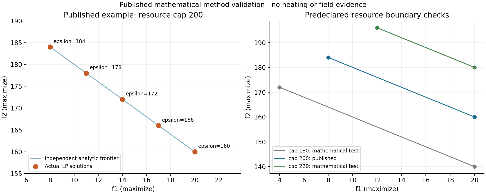

# 已发表双目标 LP 的方法复现

这是工程实际 LinearMILP 数值层加独立两阶段词典序包装的数学验证。未调用 HeatPlanningModel.solve_lexicographic；未复现完整 AUGMECON 松弛加权/提前退出。供热工程前沿和实测验证均为 false。

来源为 [George Mavrotas 官方 GAMS 作者报告](https://www.gams.com/modlib/adddocs/epscm.pdf)，第 4.1 节（物理第 6 页）、表 2/图 2（第 7 页）、四等分规则（第 8 页）、图 4（第 9 页）。模型为 max f1=x1，max f2=3x1+4x2，x1≤20，x2≤40，5x1+4x2≤200。非负域依据图 2 解释，公式未单列下界。

原 PDF SHA256：`964c7bef93a278a4bea264a1d6f8fb51faf328644f3034215e871343eea3730a`。下载时间与 HTTP 信息见输入快照 source_manifest.json；未将 HTTP 修改时间当论文发表日期。

先保存 predeclared_plan.json，后运行实验。原文表 2 仅作验证参照；第二阶段等式固定实际第一阶段求解值。ε 由实际端点范围四等分后核对预声明 160/166/172/178/184，三个中间值是推导值。180/220 资源上限是数学边界检验协议，不是论文数据或现场数据。

| 顺序 | 实际 x1 | 实际 x2 | 实际 f1 | 实际 f2 |
|---|---:|---:|---:|---:|
| f1→f2 | 20 | 25 | 20 | 160 |
| f2→f1 | 8 | 40 | 8 | 184 |

| ε | 实际 x1 | 实际 x2 | 实际 f1 | 实际 f2 |
|---:|---:|---:|---:|---:|
| 160 | 20 | 25 | 20 | 160 |
| 166 | 17 | 28.75 | 17 | 166 |
| 172 | 14 | 32.5 | 14 | 172 |
| 178 | 11 | 36.25 | 11 | 178 |
| 184 | 8 | 40 | 8 | 184 |

共 23 次小 LP：22 次 status=0，预声明负例（资源180、ε184）status=2 且无解向量；无第二阶段。5 个 ε 点均唯一且互不支配。数值全矩阵审计和独立有理数多边形解析界核对全部通过。求解累计 0.017743 秒；每阶段时间/状态/界见 stages.csv。

LP 未暴露的 mip_dual_bound/mip_gap 保留 null，不虚报为零；独立解析最优界另列，不冒称求解器给出的界。所有变量边界、完整矩阵、逐行活动/松弛、实际向量和目标重算保存在每阶段 JSON。容差和10秒时限是数值协议，非原文参数。

最大行违反 0，最大变量界违反 0，最大目标重算误差 0。源文件/输入/协议/执行脚本/数值核心/测试文件均有 SHA256 快照，开始和结束身份相等；complete manifest 最后写入。

此证据不证明建筑 RC 参数、工程费用/碳排改善、完整年季可行性或现场预测精度，也不改变任何供热情景数据准入状态。
